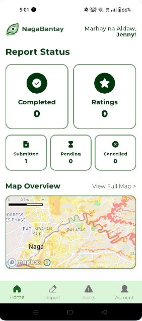
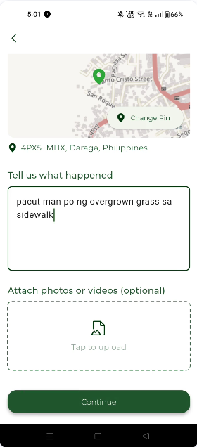
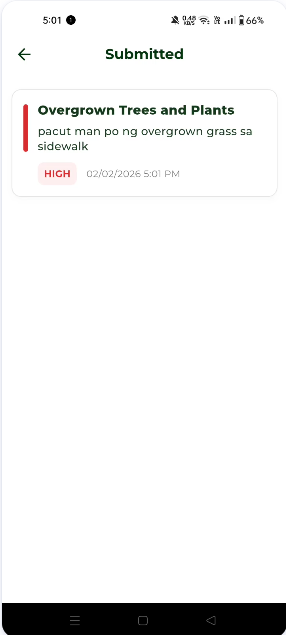
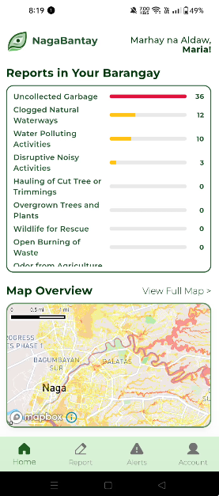
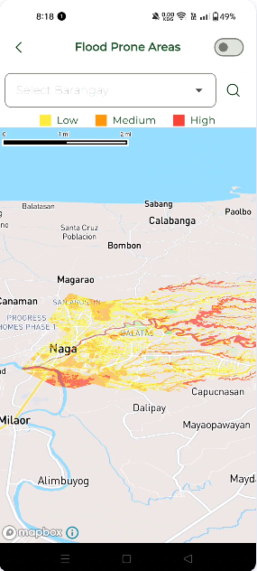
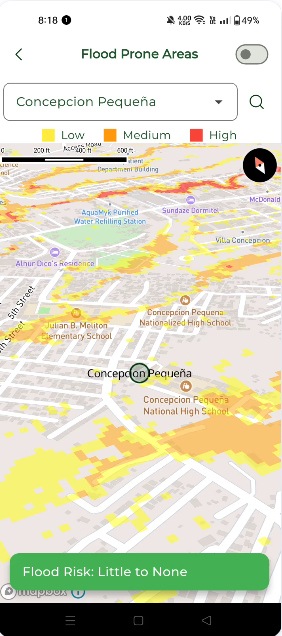
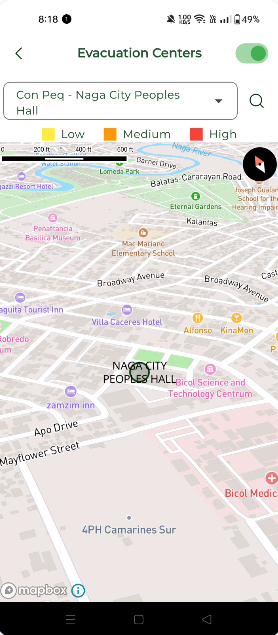
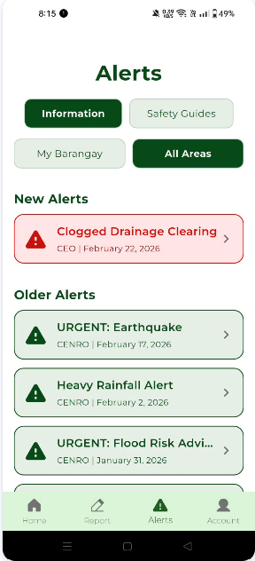
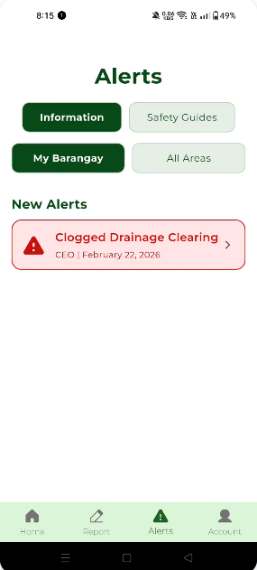

# NagaBantay

*Parabantay nin gabos na barangay* (A guardian for every barangay)

NagaBantay is a mobile and web platform for environmental and disaster reporting in Naga City. Residents submit reports from their mobile devices, barangay officials receive and manage them through a web dashboard, and the community is kept informed through alerts, hazard maps, and safety guides.

**Note on this repository:** The source code is maintained in a private repository. This public repository serves as a showcase, providing an overview of the project, the features I developed, and a demonstration video.

---

## Demonstration

[Watch the demo video](https://drive.google.com/file/d/1-scLLS9XByd0S9DB_TCpkXyPlSMwD4gt/view?usp=drive_link)

### Reporting and Tracking

<table>
  <tr>
    <td align="center"> Home screen with report status summary</td>
    <td align="center"> Report form with pinned location and description</td>
    <td align="center"> Submitted report with severity level</td>
  </tr>
</table>

### Barangay Dashboard

<table>
  <tr>
    <td align="center"> Report counts by category within the resident's barangay</td>
  </tr>
</table>

### Hazard Maps

<table>
  <tr>
    <td align="center"> City-wide flood-prone areas by severity</td>
    <td align="center"> Flood risk lookup for a selected barangay</td>
    <td align="center"> Searchable evacuation centers</td>
  </tr>
</table>

### Alerts

<table>
  <tr>
    <td align="center"> Alerts for all areas, with new and older alerts separated</td>
    <td align="center"> Alerts filtered to the resident's barangay</td>
  </tr>
</table>

---

## My Role

**Mobile Application Developer.** I designed and developed the resident-facing mobile application in Flutter, including all features listed below, from the report submission flow to the hazard maps and alert system. The barangay-facing web platform was developed by my teammates.

---

## Mobile Application Features

### Report Submission
Residents submit a report by:
- Selecting an issue from categorized options (Solid Waste Management; Environment and Natural Resources), such as uncollected garbage, open burning of waste, clogged natural waterways, and wildlife for rescue
- Pinning the exact location on a map
- Providing a written description
- Attaching a photograph as supporting evidence

### Report Tracking
Residents can view their submitted reports along with each report's severity level, status, and submission time. Once a report is resolved, the resident is prompted to rate the response on a five-star scale, giving the barangay a feedback loop on service quality.

### Barangay Dashboard
The home screen presents an analytics dashboard of reports within the resident's own barangay, with per-category counts and a visual indicator that highlights the most frequently reported issue. A map preview with flood risk overlay is displayed beneath it.

### Flood-Prone Area and Evacuation Maps
An interactive Mapbox map with two modes:
- **Flood mode:** Flood-prone areas are shaded by severity (low, medium, high). Residents can select any of Naga City's barangays to fly to it and instantly see its flood risk level.
- **Evacuation mode:** Evacuation centers are plotted on the map and can be searched by barangay and facility name.

### Barangay Alerts
Alerts issued by barangay officials through the web platform are delivered to the app in real time. Residents can filter between alerts for their own barangay and alerts for all areas. New alerts (within the last 24 hours) are visually highlighted and accompanied by an audible notification, with older alerts listed separately.

### Personalized Safety Guides
Safety guidance is generated from the alerts affecting the resident's barangay. Each guide includes a stated goal and a step-by-step checklist, and covers floods, typhoons, extreme heat, fire incidents, waste collection, drainage clearing, and tree pruning. Guides are also shown directly within each alert's detail view. When no relevant alerts are active, general guides for typhoons, fires, and floods are displayed.

---

## System Overview

| Component | Users | Functions |
|-----------|-------|-----------|
| Mobile application (my contribution) | Residents | Submit and track reports, view area dashboard and hazard maps, receive alerts, read safety guides |
| Web platform | Barangay and city offices | Review reports, issue alerts and announcements, view analytics |

---

## Technology Stack

| Area | Technologies |
|------|--------------|
| Framework | Flutter, Dart |
| Authentication | Firebase Authentication (phone number) |
| Database and real-time sync | Cloud Firestore |
| Maps | Mapbox Maps SDK for Flutter, GeoJSON hazard and evacuation datasets |
| Other libraries | audioplayers, dropdown_search, phosphor_flutter, flutter_dotenv |

---

## Background

NagaBantay originated as a hackathon project and is being developed into a startup intended to help Naga City's barangays respond more effectively to community and environmental concerns.

---

## Contact

**Jenny**
Computer Science, Cum Laude, Bicol University

- GitHub: https://github.com/jennyBarbacena
- LinkedIn: https://www.linkedin.com/in/jenny-barbacena2026/
